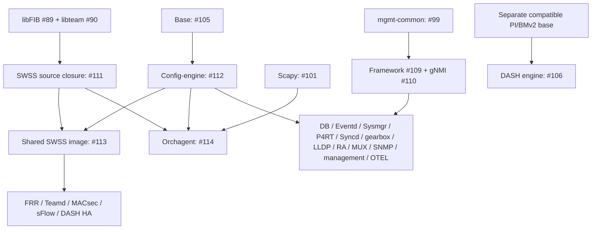

# AMD64 Docker migration plan

Status snapshot: **2026-11-03 UTC**. Track execution in
[buildimage issue #88](https://github.com/securely1g/sonic-buildimage/issues/88)
and [Project #1 TODO](https://github.com/users/securely1g/projects/1/views/8).
The linked issues and PR checks carry subsequent updates.

This plan covers **23 Docker families: 20 runtime families and three shared
bases**. It replaces the earlier 31-family execution scope and the broader
111-definition inventory. The
[2026-10-29 component inventory](sonic_vs_bazel_migration_tracker.md)
remains a historical reference, not the current completion checklist.

## Scope and baseline

Use the merged [buildimage PR #64](https://github.com/securely1g/sonic-buildimage/pull/64),
commit [`c743d7521e80fc1733e5cc0ffc24889b08f78444`](https://github.com/securely1g/sonic-buildimage/commit/c743d7521e80fc1733e5cc0ffc24889b08f78444),
as the implementation baseline. The selected profile is native Linux AMD64
execution and AMD64 targets, Debian Trixie, VS, DASH and FIPS enabled,
ASAN and Syncd RPC disabled.

A Docker migration includes its complete required project source dependency
graph: inherited bases, applications, libraries, generators, native bindings,
Python wheels, configuration and applicable debug outputs. Adding an image
BUILD file alone does not complete a Docker migration.

- Produce source-owned libraries, binaries, runtime/debug TARs and wheels.
  Consume those outputs directly in OCI assembly. **No DEB generation is
  authorized in this phase**, including indirect build or test targets.
- Keep legacy Make package compatibility separate. The new Bazel path must
  not require pre-existing project DEBs or Make's package cache. Reuse normal
  Bazel caches and existing outputs from declared source actions.
- Locked Debian packages are allowed external inputs. Downloading and
  extracting them is distinct from generating DEBs. A project-maintained or
  SONiC-patched producer cannot be replaced silently with a binary download.
- Reuse public `rules_oci`, `rules_distroless`, `tar.bzl` and `rules_gzip` for
  their applicable roles. Consumers use those components directly; a new
  custom archive parser, converter or shared importer requires explicit
  approval under the [migration skill](sonic-bazel-migration/SKILL.md).
- Reusable libraries belong to their source owner. This includes Rust:
  Common owns its reusable Rust library, and SWSS consumes that target.
  Do not compile another repository's reusable library in each consumer.
- New ARM64, ARMHF, cross-compilation and emulation work is deferred. Preserve
  existing multi-architecture implementations and required CI; this plan
  does not authorize removing them.

The Project Area **`base image`** independently identifies host OS, rootfs,
kernel and installer work. It is not a 24th Docker and can coexist with
Docker tags.

## Deferred families

The following eight families and work needed exclusively by them are out of
scope: `docker-nat`, `docker-gnmi-sidecar`, `docker-restapi-sidecar`,
`docker-gnmi-watchdog`, `docker-bmp-watchdog`, `docker-dhcp-relay`,
`docker-platform-monitor` and `docker-sonic-bmp`.

The earlier `restapi-watchdog` request was clarified to mean BMP watchdog.
Platform-monitor-only daemon wheels and sensors work, and DHCP-relay-only
ISC/SONiC relay, DHCP monitor, PcapPlusPlus and DHCP utility work are deferred.
Shared packages remain active when a retained consumer needs them: for
example, platform-common for SNMP and MACsec, and SWSS/Common for the active
network services.

Deferred containers may continue through their existing Make paths in the
VS installer. This changes migration scope, not product features. Report
that mixed build provenance in final image results.

## Progress and remaining Docker work

**Existing** means merged image support exists at the PR #64 baseline; it
does not establish complete source or service parity. **Component CI green**
means the applicable checks passed at the recorded head, not that its
dependencies have landed or that full VS/hardware acceptance is complete.
**In progress** includes implementations whose acceptance is still running.
Referenced buildimage PRs remain proposals unless explicitly identified as
merged. See the head snapshot below for the observed CI results.

The parent column describes the selected profile. All inherited project
dependencies remain part of the child's completion criteria.

### Shared bases — 3

| Docker / issue | Parent and project packages | Current work and remaining acceptance |
| --- | --- | --- |
| `docker-base-trixie` · [#105](https://github.com/securely1g/sonic-buildimage/issues/105) | Locked Debian base; source socat, iproute2, FIPS OpenSSL, Kerberos and SymCrypt | **Existing.** Source FIPS debug work in [sonic-fips #11](https://github.com/securely1g/sonic-fips/pull/11) has green component CI; [registry #184](https://github.com/securely1g/sonic-bazel-registry/pull/184) acceptance is in progress. Whole-core/runtime-TAR reproducibility still has gaps from a fresh integrity HMAC key and generated-assembly debug paths. #11 verifies complete unstripped provider/engine ELF and DWARF reproducibility, not the whole core TAR. |
| `docker-config-engine-trixie` · [#112](https://github.com/securely1g/sonic-buildimage/issues/112) | Base; Common C++/Python/DB CLI/Rust, libyang and Python/CFFI bindings, libnl, eventd, supervisor Rust/Python utilities, config-engine, py-common, YANG models and containercfgd | **Existing.** [#133](https://github.com/securely1g/sonic-buildimage/pull/133) has component CI green. Reuse the exact source-selected redis-dump-load archive and existing generators. Finish dependency publication and selected installed-state/VS acceptance. |
| `docker-swss-layer-trixie` · [#113](https://github.com/securely1g/sonic-buildimage/issues/113) | Config-engine; full SWSS/Common, SAI Redis/metadata, DASH API, patched libteam and the selected libFIB interface | New source integration [#135](https://github.com/securely1g/sonic-buildimage/pull/135) and shared image [#136](https://github.com/securely1g/sonic-buildimage/pull/136) have component CI green. Installed checks cover 41 source ELFs, loader dependencies and matching symbols. Finish publication and consumer/full VS acceptance. |

### Existing and core services — 6

| Docker / issue | Parent and project packages | Current work and remaining acceptance |
| --- | --- | --- |
| `docker-orchagent` · [#114](https://github.com/securely1g/sonic-buildimage/issues/114) | **Config-engine in the selected FIPS profile**; SWSS, Common, SAI Redis/metadata, DASH API, patched native dependencies and Scapy | **Existing.** Reuse #135 source closure. Convert the selected Scapy source wheel in [#101](https://github.com/securely1g/sonic-buildimage/issues/101); finish selected runtime/debug and final image acceptance. It does not inherit the new shared SWSS image in this profile. |
| `docker-syncd-vs` · [#115](https://github.com/securely1g/sonic-buildimage/issues/115) | Config-engine; SAI Redis/metadata/vslib/syncd, Common, libnl, selected FIPS OpenSSH and existing PI → BMv2 → p4c → DASH source chain | **Existing.** Reuse the source chain already implemented. Verify its selected native AMD64/Trixie/DASH/FIPS closure, archive selection and runtime/debug acceptance; do not start duplicate P4 producers. |
| `docker-database` · [#116](https://github.com/securely1g/sonic-buildimage/issues/116) | Config-engine; Common/DB CLI, DASH API, locked distribution Redis and source configuration | [#142](https://github.com/securely1g/sonic-buildimage/pull/142) has component CI green. Finish dependency publication and same-artifact VS integration. |
| `docker-eventd` · [#117](https://github.com/securely1g/sonic-buildimage/issues/117) | Config-engine; existing eventd, event DB, events tool and rsyslog plugin producers, Common and selected Python utilities | [#141](https://github.com/securely1g/sonic-buildimage/pull/141) has component CI green. Reuse owner source outputs; finish publication and same-artifact VS integration. |
| `docker-sysmgr` · [#118](https://github.com/securely1g/sonic-buildimage/issues/118) | Config-engine; sysmgr/rebootbackend, Common, protobuf/gNOI/DBus generation | Reuse [#5](https://github.com/securely1g/sonic-buildimage/pull/5) through source issue [#102](https://github.com/securely1g/sonic-buildimage/issues/102). Reconcile runtime/debug APIs and current upstream OCI rules, then validate service/reboot-backend behavior. |
| `docker-sonic-p4rt` · [#119](https://github.com/securely1g/sonic-buildimage/issues/119) | Config-engine; sonic-pins/P4RT, source-owned Common libraries/schema, selected SDK/toolchain, startup assets | Existing source build must expose production runtime/debug TARs through [#103](https://github.com/securely1g/sonic-buildimage/issues/103); reuse applicable [#36](https://github.com/securely1g/sonic-buildimage/pull/36) work. Add OCI integration and installed service checks without running `p4rt_deb` or `p4rt_dbg_deb`. |

### Network services — 4

| Docker / issue | Parent and project packages | Current work and remaining acceptance |
| --- | --- | --- |
| `docker-fpm-frr` · [#129](https://github.com/securely1g/sonic-buildimage/issues/129) | SWSS layer; FRR, libFIB/libnexthopgroup, libyang, bgpcfgd and frr-management source wheels | [#137](https://github.com/securely1g/sonic-buildimage/pull/137) implemented; final current-head image acceptance is in progress. Reuse owner work in [#107](https://github.com/securely1g/sonic-buildimage/issues/107), [#51](https://github.com/securely1g/sonic-buildimage/pull/51) and [#67](https://github.com/securely1g/sonic-buildimage/pull/67). Finish routing/forwarding and final VS acceptance. |
| `docker-teamd` · [#130](https://github.com/securely1g/sonic-buildimage/issues/130) | SWSS layer; SONiC-patched libteam, libteamdctl, tools/teamd, libnl and Jansson | [#140](https://github.com/securely1g/sonic-buildimage/pull/140) has component CI green. Reuse the shared producer from [#61](https://github.com/securely1g/sonic-buildimage/pull/61); finish publication and VS/LAG integration. |
| `docker-lldp` · [#121](https://github.com/securely1g/sonic-buildimage/issues/121) | Config-engine; patched lldpd/lldpcli, sonic-dbsyncd (`sonic_d`) source wheel and Common bindings | [#144](https://github.com/securely1g/sonic-buildimage/pull/144) has component CI green, including private veth/Redis service checks and runtime/debug ELF validation. Source issues [#91](https://github.com/securely1g/sonic-buildimage/issues/91)/[#92](https://github.com/securely1g/sonic-buildimage/issues/92) have implementations to reuse. Publication and VS integration remain. |
| `docker-router-advertiser` · [#122](https://github.com/securely1g/sonic-buildimage/issues/122) | Config-engine; locked distribution radvd, source-owned configuration and scripts | [#143](https://github.com/securely1g/sonic-buildimage/pull/143) has component CI green. Finish publication and final VS acceptance. No new radvd source conversion is required for an unpatched distribution input. |

### Management and observability — 4

| Docker / issue | Parent and project packages | Current work and remaining acceptance |
| --- | --- | --- |
| `docker-snmp` · [#124](https://github.com/securely1g/sonic-buildimage/issues/124) | Config-engine; sonic-snmpagent (`asyncsnmp`/`sonic_ax_impl`), platform-common, Common/py-common and locked Trixie snmp/snmpd | [#134](https://github.com/securely1g/sonic-buildimage/pull/134) has component CI green. Owner evidence includes 419 original tests with seven existing skips, installed checks and runtime/debug AgentX GET/GETNEXT. Publication, multi-namespace and hardware/VS acceptance remain. The Bookworm-only Net-SNMP source recipe is outside this Trixie scope. |
| `docker-sonic-mgmt-framework` · [#125](https://github.com/securely1g/sonic-buildimage/issues/125) | Config-engine; mgmt-common YANG/CVL/translib/generators, framework REST/CLI/UI and certificate/OpenAPI tooling | [#138](https://github.com/securely1g/sonic-buildimage/pull/138) has component CI green. Reuse shared [#99](https://github.com/securely1g/sonic-buildimage/issues/99) and owner [#109](https://github.com/securely1g/sonic-buildimage/issues/109); finish publication and final VS service acceptance. |
| `docker-sonic-gnmi` · [#126](https://github.com/securely1g/sonic-buildimage/issues/126) | Config-engine; shared mgmt-common, telemetry/gNMI/gNOI, SWIG/CGO/protobuf generators and selected Go dependencies | Owner [sonic-gnmi #2](https://github.com/securely1g/sonic-gnmi/pull/2), [registry #182](https://github.com/securely1g/sonic-bazel-registry/pull/182) and image [#148](https://github.com/securely1g/sonic-buildimage/pull/148) are in progress. Production source tests and generator checks have passed; external consumer/current image acceptance remains. |
| `docker-sonic-otel` · [#127](https://github.com/securely1g/sonic-buildimage/issues/127) | Config-engine; OTEL collector and local configuration | Resolve [#100](https://github.com/securely1g/sonic-buildimage/issues/100): source producer or explicitly accepted checksum-pinned official binary contract, including debug availability. Then implement image/service acceptance. A binary exception has not been inferred from its current download recipe. |

### Specialized services — 6

| Docker / issue | Parent and project packages | Current work and remaining acceptance |
| --- | --- | --- |
| `docker-macsec` · [#131](https://github.com/securely1g/sonic-buildimage/issues/131) | SWSS layer; selected SONiC wpa-supplicant, Common/Python/libyang and required platform-common utilities | Owner [#93](https://github.com/securely1g/sonic-buildimage/issues/93) has source/TAR/test/CodeQL CI green; [registry #185](https://github.com/securely1g/sonic-bazel-registry/pull/185) consumer acceptance is in progress. Image graph audit passed; build and private MACsec service acceptance remain. |
| `docker-mux` · [#123](https://github.com/securely1g/sonic-buildimage/issues/123) | Config-engine; linkmgrd, Common/libnl and selected Boost 1.83 runtime | [sonic-linkmgrd #1](https://github.com/securely1g/sonic-linkmgrd/pull/1) has source CI green, 189 original tests plus three installed checks, and matching local/CI TAR hashes. [Registry #183](https://github.com/securely1g/sonic-bazel-registry/pull/183) and image [#147](https://github.com/securely1g/sonic-buildimage/pull/147) acceptance is in progress. Private Redis/veth checks do not establish physical dual-ToR behavior. |
| `docker-sflow` · [#132](https://github.com/securely1g/sonic-buildimage/issues/132) | SWSS layer; hsflowd, sflowtool, psample, Common and selected netlink/kernel interfaces | sflowtool [#96](https://github.com/securely1g/sonic-buildimage/issues/96) implementation started. hsflowd [#95](https://github.com/securely1g/sonic-buildimage/issues/95) and psample [#97](https://github.com/securely1g/sonic-buildimage/issues/97) are separate producer work. All three precede final sampling/image acceptance. |
| `docker-dash-ha` · [#128](https://github.com/securely1g/sonic-buildimage/issues/128) | SWSS layer; DASH HA native owner output and inherited SWSS/Common dependencies | Implement source issue [#104](https://github.com/securely1g/sonic-buildimage/issues/104), then runtime/debug OCI, startup/configuration and HA acceptance. Reuse the shared SWSS image and owner APIs. |
| `docker-gbsyncd-vs` · [#120](https://github.com/securely1g/sonic-buildimage/issues/120) | Config-engine; gearbox configuration over existing SAI Redis/vslib/syncd, Common/libnl and selected P4 dependencies | Reuse Syncd/SAI/P4 producers; add explicit gearbox variant configuration, runtime/debug image composition and gearbox acceptance. No duplicate native source chain is planned. |
| `docker-dash-engine` · [#106](https://github.com/securely1g/sonic-buildimage/issues/106) | Separate behavioral-model base; PI/BMv2 runtime and source startup/configuration scripts | Replace the mutable `p4lang/behavioral-model:latest` assumption with a declared compatible source/pinned base contract. Reuse existing PI/BMv2 producers where compatible; verify that compatibility before claiming this family inherits the Trixie base. |

### Observed image PR heads

These are reproducible status references, not module pins or merge approvals.
Skipped jobs are not counted as passed. Full VS and pending publication remain
separate from the component results above.

| Buildimage PR | Head at observation | Result at snapshot |
| --- | --- | --- |
| [#133](https://github.com/securely1g/sonic-buildimage/pull/133) | `87cb1a84` | Applicable component checks green |
| [#134](https://github.com/securely1g/sonic-buildimage/pull/134) | `c8950c28` | Applicable component checks green |
| [#135](https://github.com/securely1g/sonic-buildimage/pull/135) | `4b2951e3` | Applicable component checks green |
| [#136](https://github.com/securely1g/sonic-buildimage/pull/136) | `c9924a2a` | Applicable component checks green |
| [#137](https://github.com/securely1g/sonic-buildimage/pull/137) | `0f37b201` | Final image acceptance in progress |
| [#138](https://github.com/securely1g/sonic-buildimage/pull/138) | `c38b53a1` | Applicable component checks green |
| [#140](https://github.com/securely1g/sonic-buildimage/pull/140) | `0aa69371` | Applicable component checks green |
| [#141](https://github.com/securely1g/sonic-buildimage/pull/141) | `2258932c` | Applicable component checks green |
| [#142](https://github.com/securely1g/sonic-buildimage/pull/142) | `dd90ff75` | Applicable component checks green |
| [#143](https://github.com/securely1g/sonic-buildimage/pull/143) | `5f6009a4` | Applicable component checks green |
| [#144](https://github.com/securely1g/sonic-buildimage/pull/144) | `f23d8823` | Applicable component checks green |
| [#147](https://github.com/securely1g/sonic-buildimage/pull/147) | `d306dd6f` | Build and current-head acceptance in progress |
| [#148](https://github.com/securely1g/sonic-buildimage/pull/148) | `e28524ec` | Build and current-head acceptance in progress |

## Shared package work — 21 issues

Each producer is implemented once and exposes an owner API to all affected
containers. Source conversion, registry publication and Docker integration
are separate work items. An existing implementation below should be reused,
not recreated because its tracking issue remains open.

| Issue | Owner output / remaining conversion | Consumers or integration gate |
| --- | --- | --- |
| [#89](https://github.com/securely1g/sonic-buildimage/issues/89) | libFIB/libnexthopgroup runtime/debug and schema interfaces; implementation exists in #51 | FRR and the verified SWSS native interface; inherited SWSS consumers reuse it where selected |
| [#90](https://github.com/securely1g/sonic-buildimage/issues/90) | SONiC-patched libteam/libteamdctl/tools, headers and matching symbols; implementation exists in #61 | SWSS/Orchagent, Teamd and shared SWSS descendants |
| [#91](https://github.com/securely1g/sonic-buildimage/issues/91) | Patched lldpd/lldpcli runtime/debug; implemented and exercised by #144 | LLDP |
| [#92](https://github.com/securely1g/sonic-buildimage/issues/92) | sonic-dbsyncd wheel, installed entry point and Common binding contract; implemented and exercised by #144 | LLDP; can be developed independently of lldpd |
| [#93](https://github.com/securely1g/sonic-buildimage/issues/93) | Selected wpa-supplicant runtime/debug; source CI green, ordinary registry consumer pending | MACsec |
| [#94](https://github.com/securely1g/sonic-buildimage/issues/94) | linkmgrd libraries/daemon, runtime/debug and owner metadata; source CI green, ordinary registry consumer pending | MUX |
| [#95](https://github.com/securely1g/sonic-buildimage/issues/95) | hsflowd runtime/debug with selected SONiC configuration and patch inputs; remaining producer work | sFlow |
| [#96](https://github.com/securely1g/sonic-buildimage/issues/96) | sflowtool decoder/forwarder runtime/debug; implementation started | sFlow; independent of hsflowd/psample source conversion |
| [#97](https://github.com/securely1g/sonic-buildimage/issues/97) | psample runtime/debug and selected kernel/netlink interface; remaining producer work | sFlow |
| [#98](https://github.com/securely1g/sonic-buildimage/issues/98) | platform-common source wheel and installed APIs; implementation exists and is consumed by SNMP | SNMP, MACsec and applicable Eventd utility dependencies; not all deferred PMON packages |
| [#99](https://github.com/securely1g/sonic-buildimage/issues/99) | mgmt-common YANG/CVL/translib, generators and coherent Go/C interfaces; implementation exists | Framework and gNMI; publish once for both |
| [#100](https://github.com/securely1g/sonic-buildimage/issues/100) | Resolve OTEL source versus explicitly accepted official binary contract and debug availability | OTEL; decision before image completion |
| [#101](https://github.com/securely1g/sonic-buildimage/issues/101) | Selected Scapy source wheel and installed import/behavior checks | Orchagent; independent producer work |
| [#102](https://github.com/securely1g/sonic-buildimage/issues/102) | Reconcile existing Sysmgr/rebootbackend TARs and protobuf/gNOI/DBus generation from #5 | Sysmgr |
| [#103](https://github.com/securely1g/sonic-buildimage/issues/103) | Expose P4RT production runtime/debug TARs, public visibility and owner/Common/toolchain boundaries | P4RT; reuse existing source build, omit DEB targets |
| [#104](https://github.com/securely1g/sonic-buildimage/issues/104) | DASH HA source-owned runtime/debug and tests | DASH HA; integration also requires the shared SWSS layer |
| [#107](https://github.com/securely1g/sonic-buildimage/issues/107) | FRR native output plus existing bgpcfgd/frr-management wheel parity; implementation exists | FRR; consumes #89, then integrates through #129 |
| [#108](https://github.com/securely1g/sonic-buildimage/issues/108) | sonic-snmpagent wheel and AgentX install assets; source and image component CI green | SNMP image also needs #98 and final service/VS acceptance; the independent agent wheel imports Common/py-common, not platform-common |
| [#109](https://github.com/securely1g/sonic-buildimage/issues/109) | Framework REST/CLI/UI/cert/OpenAPI runtime and symbols; implemented, image component CI green | Framework; shared #99 |
| [#110](https://github.com/securely1g/sonic-buildimage/issues/110) | gNMI/gNOI production programs, SWIG/CGO/protobuf generation and symbols; acceptance in progress | gNMI; shared #99 |
| [#111](https://github.com/securely1g/sonic-buildimage/issues/111) | Full SWSS runtime/debug and native dependency parity; #135 component CI green | Orchagent and shared SWSS layer descendants; reuse #89/#90 and owner Common/Rust APIs |

Build-time prerequisites are not automatically installed payloads. For
example, a `_INSTALL_DEBS` or `_INSTALL_PYTHON_WHEELS` entry can prepare the
build slave without belonging in a container. Check the selected Make and
Docker recipes, linked libraries, Python imports and installed files before
adding a runtime dependency. Keep generators and headers separate from the
runtime TAR contract.

## Dependency order and parallel execution

The broad dependency structure is:

This is an ordering aid; the issue tables above identify the individual
producer gates. In particular, the selected FIPS Orchagent uses config-engine
directly. It shares SWSS **source outputs** without depending on the shared
SWSS **image**.

| Parallel lane | Work ready to continue | Gate before its Docker is complete |
| --- | --- | --- |
| Shared foundations | Finish FIPS/base gaps and publication; retain green config-engine and SWSS image evidence | Selected source/registry pins published; inherited runtime/debug contract verified |
| Network | Finish current FRR acceptance; preserve green Teamd and LLDP work | FRR needs libFIB + SWSS layer; Teamd needs libteam + SWSS layer; LLDP needs both lldpd and dbsyncd + config-engine |
| Management | Finish gNMI owner, registry and image acceptance alongside green framework/SNMP publication | mgmt-common once for framework/gNMI; platform-common once for SNMP and other selected consumers |
| MACsec and MUX | Finish ordinary registry consumer checks and images after their green owner builds | WPA + SWSS layer for MACsec; linkmgrd + config-engine for MUX |
| Remaining source conversions | Scapy, hsflowd, sflowtool, psample and DASH HA can proceed independently in separate owner worktrees | sFlow waits for all three producers; DASH HA waits for its source plus SWSS layer |
| Existing proposals and contracts | Reconcile Sysmgr #5 and P4RT #36/TAR work; investigate OTEL and DASH-engine contracts independently | Production source APIs and declared external/base inputs before final image acceptance |
| Final integration | Prepare archive selection and separate validation using already built artifacts | Required selected family outputs and explicitly authorized full VS build scope |

Parallelism is by independent producer or image family, not by creating
multiple implementations of a shared package. Use isolated worktrees,
Bazel output bases and private Docker/Redis/network state, with shared trusted
download/action caches. Limit simultaneous heavy compiles to runner memory
and I/O capacity. Run one full VS integration per qualified runner initially.

## Delivery boundaries and acceptance

1. **Source owner PR:** maintained BUILD targets near their sources; declared
   generators and dependencies; public library/runtime/debug/wheel APIs;
   original tests and installed-artifact checks. For an external source
   package, a declared `rules_foreign_cc` configure/Make action is acceptable;
   an opaque wrapper around the whole SONiC build is not source migration.
2. **Registry/shared support PR:** publish the selected source and integrity,
   necessary shared rule fixes and an ordinary external-consumer build.
   A local override or metadata-resolution-only result is insufficient.
3. **Docker integration PR:** direct OCI composition, source-owned startup
   and configuration, explicit Make archive selection, runtime/debug
   outputs and private installed-service acceptance. Runtime and debug
   variants share source compile outputs.
4. **Final VS integration:** build `sonic-vs.bin` once using those selected
   archives. Run post-build archive, source-package and P4 checks as separate
   steps against the same outputs. Keep Make's internal boot checks in the
   image recipe; do not move them under this plan. If the selected full build
   still creates DEBs, obtain approval for that scope before executing it.

For each applicable producer and family, retain evidence for:

- Exact source, registry, toolchain and image revisions and the AMD64 profile.
- A clean-checkout build without project Make packages, plus warm/no-op and
  representative edit/restore runs that demonstrate correct cache reuse.
- Original source tests, generated-input invalidation and a real consumer.
- Installed paths, permissions, entry points, native loader/ABI dependencies,
  Python/Go/Rust interfaces and runtime/debug build-ID agreement.
- Reproducible artifact hashes, OCI platform/tags and archive contents.
- Meaningful installed service behavior; distinguish private fixtures from
  hardware, multi-namespace, physical MACsec, gearbox or dual-ToR coverage.
- Current-head CI results. Do not treat skipped, cancelled, stale-head or
  still-running jobs as passing evidence.

Preserve existing outputs and fix failures incrementally. A final clean-state
verification should demonstrate reproducibility without repeatedly throwing
away working caches during development. Avoid rebuilding a variant solely
to validate it when the same artifact was already produced for the image.

Track all 21 package/interface issues and 23 Docker issues under #88. Tag
each issue and PR with every verified affected Docker; shared-base changes
include their selected descendants. Add `base image` independently for host
or installer impact. Source/registry consumers remain Draft while required
commits are unlanded. Record actual direct prerequisite PRs, not every
planning link, and keep each PR number clickable in Project #1.

This document is a plan and status snapshot. It does not authorize merges,
DEB generation, a new binary exception or changes to repository protection.
